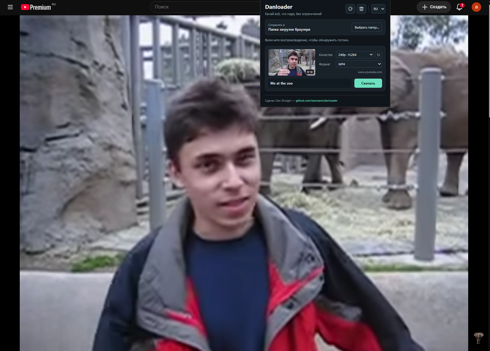

# Danloader

Расширение для поиска и скачивания видео на странице с выбором качества и общей папки сохранения.

[English](README.md)

## Поддерживаемые сервисы

- YouTube
- Instagram
- Boosty
- Kinescope (включая встроенные плееры на Sponsr)

Список будет обновляться со временем

## Установка

1. Откройте `chrome://extensions` или `edge://extensions`.
2. Включите режим разработчика и нажмите «Загрузить распакованное расширение».
3. Выберите папку `video-downloader/dist`.
4. Обновите страницу с видео и включите воспроизведение.

Откройте Danloader, выберите качество и нажмите «Скачать». Папка сохранения выбирается вверху панели и применяется ко всем видео.

[Подробности поддержки](docs/SUPPORT.md) · [Результаты проверок](docs/VERIFICATION.md)

Для разработки: `npm ci`, затем `npm run build`. Проверка TypeScript: `npm run typecheck`.
